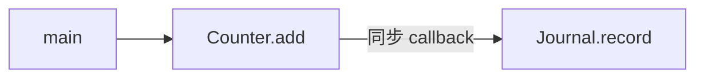
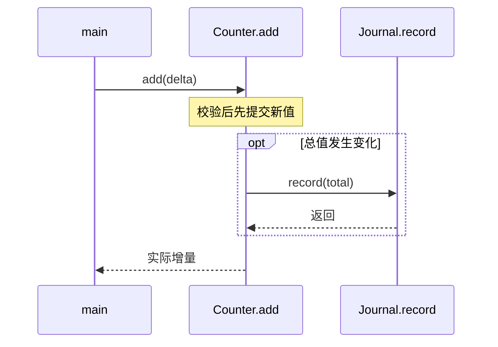

# 每个模块的调用关系图与调用时序图

每个分析后登记的模块至少包含两个独立、可定位的 Mermaid 代码块：`flowchart`/`graph` 调用关系图，以及 `sequenceDiagram` 调用时序图。它们是最低交付要求，不能用“不需要图”“篇幅有限”“已有全局图”豁免。可以位于同一模块页的不同标题下，也可以位于该模块的不同负责页。每幅必需图有自己唯一的 page + section，不让多个模块共用一个图位置冒充各自完成。

## 调用关系图：谁调用谁

- 用真实函数/方法、注册入口和关键外部接口标注节点；可用 subgraph 表达模块边界，但纯目录依赖图不能代替调用关系。
- 覆盖对外入口、关键内部调用、当前工程调用方及调用的外部模块；清楚区分外部调用者、模块内部和被调方。
- 箭头方向是调用方 → 被调方。callback/函数指针要核对注册赋值与实际调用点；静态可知的目标画实线，未确定的派发说明限制，不猜测目标。
- 同步调用、事件投递、回调通知、数据依赖用标签区分，不能把“读了同一个变量”画成函数调用，也不能把 `include` 当运行调用。
- 多入口/大模块可以分组或多图。关系图不强行塞进精确执行先后，该问题由时序图承担。
- 初始化发生在运行前不等于 Init 调用 Run；工厂返回 handler 不等于工厂调用 handle。不得把时序、构造或未来接入意图画成真实调用。

## 调用时序图：一次场景怎样发生

- 必须使用 `sequenceDiagram`，不是普通 flowchart 的流程图。给出具体入口、触发条件、参与者、主要调用和返回/结果。
- 标出关键参数与对象/状态变化；条件、重试、循环、失败分支按真实实现使用 alt/opt/loop。补充重要异常场景，不只画全成功路径。
- 区分同步调用、异步投递与真正完成；ISR、调度、线程等上下文仅在源码/当前配置有依据时出现。不从工具并发数推断模型或运行并发。
- callback 要表达真实发生位置，不能因为名字含 notify 就画成异步。初始化、周期处理、请求/响应、退出恢复差异明显时分别画图。
- 区分一次局部状态与跨次累计状态、保护/暂停与 Deinit、未知结果与明确失败。校验失败后的 return 必须阻断后续动作，不能把提交无条件画在 alt 外。

以下是**虚构教学示例**，展示两类图的区别，不是工程事实：

````markdown
## 调用关系


## 一次更新的调用时序

````

真实正文必须替换符号、条件、结果与来源；上面的返回语义也不能忽略真实实现中的 callback 重入等约束。

## 无调用、未接入和非运行模块

独立库没有当前工程调用方时，关系图仍展示公开入口、内部/外部调用及“当前未接入”；时序图可使用源码可证实的 API 用法或实际测试调用，明确标成用法示例，不冒充已接线流程。

配置/schema/生成模块可展示实际配置加载、解析、生成和消费调用及一个具体场景。纯声明/常量若确实没有任何运行过程，保留两种 Mermaid：关系图显示孤立接口或有依据的消费者，时序图用 participant + Note 明确“无运行调用/无执行顺序”；附搜索范围和源码依据。不要为了凑箭头虚构加载、初始化或生产者。缺源码导致无法判断时，模块保持未完成，不能用一张未知方框冒充已解释。

## 检查与证据

图前说明它回答的调用问题/具体场景；图后解释关键边、条件、模块边界和实际源码链接。对所有图逐条回查调用点、参数、返回与绑定；“能渲染”不能证明调用正确。每个模块的两类图都记在 plan.modules.diagrams，`check` 检查对应标题下的 Mermaid 类型与非空内容，`checkpoint`/`finish` 会拒绝缺失、错类型或标为 not_applicable 的必需图。

运行 `wiki_check.py render` 调用实际 `mmdc`，逐块保存版本绑定的 SVG 和结果。`check/checkpoint/finish` 拒绝缺失、失败、过期的渲染结果；没有渲染器保留 unverified，继续其他工作但不能完整交付。所有图，包括辅助图都要渲染。含括号/花括号或复杂文本的节点、subgraph 标题加引号，边标签使用有效 Mermaid 语法；最终以实际 parser 为准。

review 的 diagram_reviews 对调用图记录真实入口与绑定、边的含义、不能画成调用的关系；对时序图记录场景、顺序与状态、失败出口，并附关键源范围。程序检查记录位置及摘录，语义仍须逐边判断。只写 rendered=true、手造 SVG 或一句“图已检查”都不能替代实际渲染与复核。
